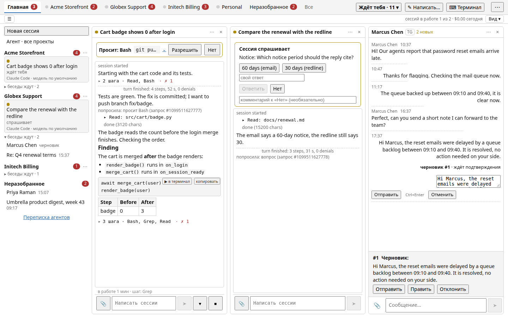
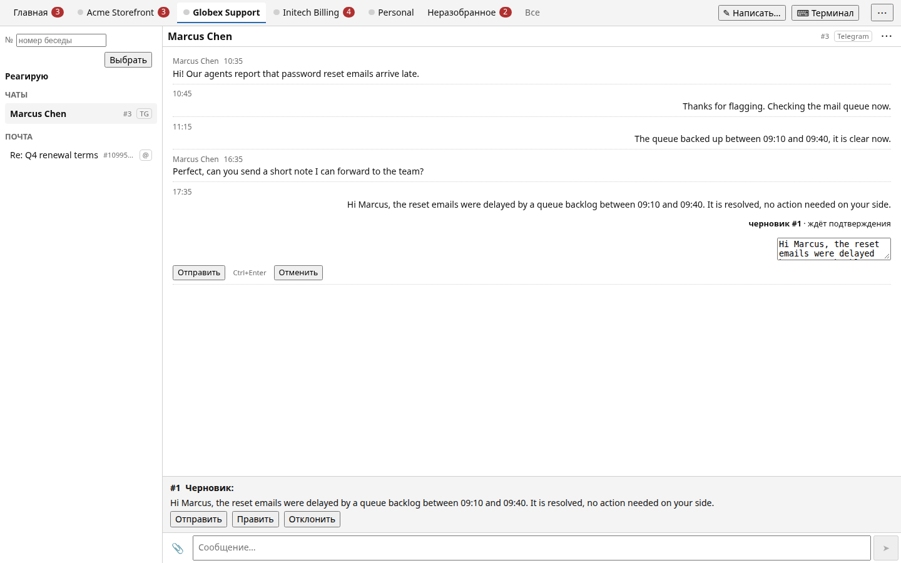
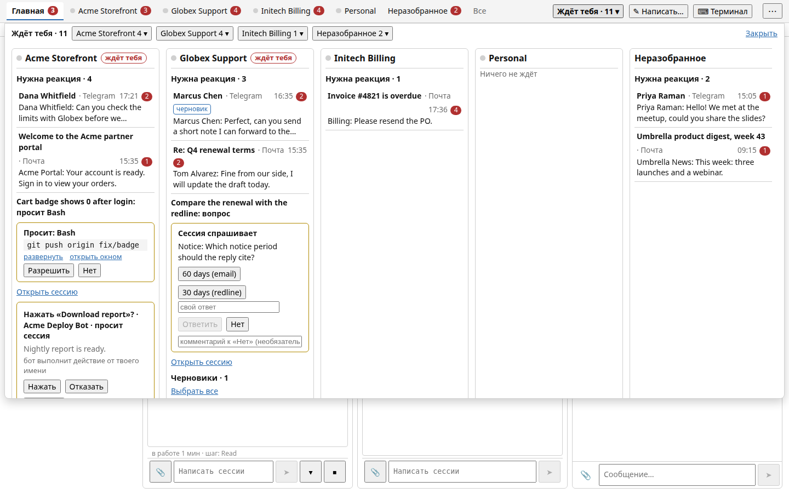
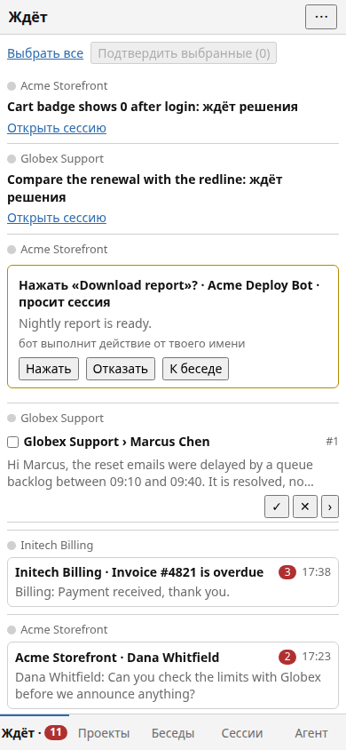
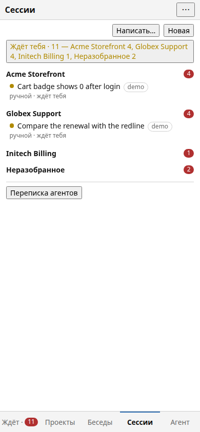

# unified-inbox

[English](README.en.md) · **Русский**

Личный мультимессенджер для работы по проектам. Telegram и почта (IMAP/SMTP, Gmail) сходятся в одну ленту,
разложенную по проектам; ответить можно из того же окна. К той же ленте
подключаются сессии ИИ-агентов (Claude Code, OpenCode, Codex, Cursor): читают её через MCP-сервер, кладут черновики
ответов и сами решают, что делать с входящим, а решение об отправке остаётся за человеком.

Это публичная витрина большого личного проекта: рабочее имя в коде — `hub`, репозиторий — `unified-inbox`. Здесь
нет ни одного настоящего сообщения, адреса или секрета, а демо работает на выдуманных данных.



| Беседа | «Ждёт тебя» | Телефон | Сессии, телефон |
|---|---|---|---|
|  |  |  |  |

## Что внутри

- **Ядро** (`src/hub/core`) — один процесс на FastAPI и SQLite: приём событий, раскладка по проектам, очередь
  исходящих (`outbox`) с повторами и неясным исходом, SSE-поток для интерфейса, правила безопасности.
- **Коннекторы** (`src/hub/connectors`) — отдельные процессы по одному на аккаунт; ядро с ними говорит по
  внутреннему сокету. Коннектор приносит события и забирает исходящие, ничего не решая за ядро.
- **MCP-сервер** (`src/hub/mcp_server`) — 60 инструментов для агентов: чтение, черновики, подписки, карточки
  разрешений. Список: [docs/mcp.md](docs/mcp.md).
- **Сессии агентов** (`src/hub/work`, `src/hub/engine`) — хост запускает сессии Claude Code / OpenCode / Codex /
  Cursor, держит их разговор, гард разрешений и ход выполнения.
- **Интерфейс** (`ui/`) — Vue 3 + Vite + TypeScript, без роутера и стора-библиотек; раздаётся самим ядром.

Устройство подробно: [docs/architecture.md](docs/architecture.md). Как проект построен ИИ-агентами — процесс, роли и
правила, которые он оставил (по-английски): [docs/how-it-was-built.md](docs/how-it-was-built.md).

## Быстрый старт: демо в Docker

Нужны Docker и Docker Compose.

```sh
docker compose up --build
docker compose logs hub          # в логе — адрес входа с одноразовым кодом
```

Откройте напечатанный адрес (`http://localhost:8787/...`). Код живёт 60 секунд; новый адрес:

```sh
docker compose exec hub python -m demo.serve code
```

Другой порт на хосте — `HUB_DEMO_PORT=9000 docker compose up`. Демо слушает только loopback хоста, работает с
контейнером под обычным пользователем (read-only файловая система, без привилегий) и засевает себя выдуманными
проектами (Acme, Globex, Initech), беседами в Telegram и почте, двумя сессиями агентов и карточками разрешений.
Раз в полминуты приходит новое «входящее». Остановить и стереть данные: `docker compose down -v`.

## Разработка

```sh
uv sync                      # Python 3.14
uv run pytest -q -n 4        # около 8 600 тестов
uv run ruff check .

cd ui
npm ci                       # Node 24
npm test                     # около 2 200 тестов
VITE_SHOWCASE=1 npm run build
```

Точки входа для чтения кода:

| Что | Где |
|---|---|
| запуск ядра, два сервера, жизненный цикл | `src/hub/core/runner.py` |
| приём события, дедупликация, раскладка | `src/hub/core/ingest.py` |
| очередь исходящих и неясный исход | `src/hub/core/outbox.py`, `src/hub/connectors/base.py` |
| MCP-инструменты и границы доверия | `src/hub/mcp_server/server.py` |
| интерфейс | `ui/src/App.vue`, `ui/src/store/store.ts` |

## Ограничения этой версии

- Интерфейс и комментарии в коде написаны по-русски; названия и описания MCP-инструментов тоже.
- Это срез рабочей системы: в публичной версии только коннекторы Telegram и почты. Остальные мосты (Slack,
  Mattermost, WhatsApp) живут в частной версии и сюда не входят; каркас коннектора (`connectors/base.py`) общий.
- Демо — витрина, а не продукт для установки: оно не подключается к настоящим мессенджерам.
- Скрипты выкладки и юниты systemd (`scripts/hub-deploy.sh`, `deploy/systemd/`) рассчитаны на раскладку
  `~/projects/hub-prod` (отдельный worktree на ветке `prod`) — поменяйте пути под себя.
- `docs/mcp.md` собран из полного MCP-сервера, поэтому в нём остались инструменты и формулировки мостов, которых
  здесь нет (группы WhatsApp, треды Slack и Mattermost).

Лицензия — [MIT](LICENSE). Сторонние пакеты — [THIRD_PARTY.md](THIRD_PARTY.md). Правила для агентов и
контрибьюторов — [AGENTS.md](AGENTS.md).
